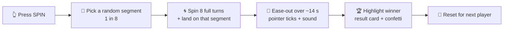

<div align="center">

# 🐂🐻 Bulls & Bears — Spin the Wheel

**An interactive spin-the-wheel stall game built for the Bulls & Bears Finance Club of PDEU.**


[Overview](#-overview) • [Features](#-features) • [The Eight Segments](#-the-eight-segments) • [How the Spin Works](#-how-the-spin-works) • [Getting Started](#-getting-started) • [Customize](#-customize)

</div>

---

## 📋 Overview

This is the digital wheel used at the **Bulls & Bears** club stall at PDEU. A visitor presses **SPIN**, the wheel runs, slows down gradually and lands on one of **eight finance topics**. Each topic comes with a short one-line message, which the stall team can use as the question or challenge for that round.

I built it as the **tech head** of the club. It runs entirely in the browser: no backend, no database and no internet needed after it loads, so it works on any laptop or screen at an event.

---

## ✨ Features

- 🎡 **Eight-segment wheel** drawn in SVG, with an icon and label on every segment
- ⏱️ **Long, smooth spin** — about **14 seconds**, fast at the start and easing out slowly, with a live countdown (*"Wheel slowing down · 12s"*)
- 🎲 **Fair random result** — every segment has the same 1-in-8 chance, and the pointer stops slightly off-centre so it looks natural
- 🔔 **Ticking pointer** — the pointer wobbles as it passes each segment
- 🔊 **Sound effects** — a tick for every segment and a chime at the end. Sound is **off by default** and toggled with the speaker icon
- 🎉 **Winner reveal** — the winning segment is highlighted, the others fade, a result card shows the topic and its message, and confetti bursts out
- 🔁 **Reset** to clear the result and get ready for the next player
- 🗂️ **"On the wheel" strip** listing all eight topics, with the current winner highlighted
- 📱 **Responsive design** for laptops, projectors and phones
- 🎨 Calm cream, green and gold theme with the club logo and *PDEU · Finance Club* branding

---

## 🧩 The Eight Segments

| # | Segment | Message shown |
|:-:|---|---|
| 01 | 📈 **Stock Market** | Read the market. Trust your strategy. |
| 02 | 🏦 **Banking** | Every good move starts with a strong foundation. |
| 03 | ✨ **Lucky Chance** | A little luck can change the game. |
| 04 | 🎁 **Bonus** | An unexpected reward is on the board. |
| 05 | 🧾 **Tax** | Know the rules before you make your move. |
| 06 | 📊 **Investment** | Think long-term. Grow with purpose. |
| 07 | 🛡️ **Scam Alert** | Stay sharp. If it looks too good, look twice. |
| 08 | 👛 **Budgeting** | Give every rupee a job. |

---

## ⚙️ How the Spin Works



1. The winner is chosen first, at random, with `Math.random()`.
2. The wheel is rotated **8 full turns** plus the exact angle needed to stop on that segment, with a small random offset inside the segment.
3. The rotation is animated with `requestAnimationFrame` and a cubic-style ease-out curve, so the wheel starts fast and slows down gradually.

---

## 🛠️ Tech Stack

| Layer | Technology |
|---|---|
| **UI** | React 18 |
| **Build tool** | Vite 6 |
| **Icons** | Lucide React |
| **Graphics** | Inline SVG, CSS animations |
| **Audio** | Web Audio API (generated tones, no audio files) |

---

## 📁 Project Structure

```
bulls-and-bears-spin-wheel/
├── public/
│   └── logo.png          # Club logo
├── src/
│   ├── main.jsx          # Wheel, spin logic, sound, result card (all in one file)
│   └── styles.css        # Layout, theme and animations
├── index.html
└── package.json
```

---

## 🚀 Getting Started

### Prerequisites

- **Node.js** 18 or later (LTS recommended)

### Run locally

```bash
git clone https://github.com/IshanPatel1912/bulls-and-bears-spin-wheel.git
cd bulls-and-bears-spin-wheel
npm install
npm run dev
```

Open the address Vite prints, usually `http://localhost:5173`.

### Production build

```bash
npm run build
npm run preview
```

The finished site is created in the `dist/` folder. You can host it on any static host, or open the preview on the stall laptop.

### Using it at the stall

1. Open the page and put the browser in **full screen** (`F11`).
2. Press the speaker icon if you want sound.
3. Let the visitor press **SPIN**, read out the result and its message, then use **Reset** for the next person.

---

## 🎨 Customize

| What to change | Where |
|---|---|
| Segment names, icons, colours and messages | the `segments` list at the top of `src/main.jsx` |
| Spin duration | `SPIN_MS` in `src/main.jsx` (default `14000` milliseconds) |
| Number of full turns | `360 * 8` inside the spin function in `src/main.jsx` |
| Confetti colours | `CONFETTI` in `src/main.jsx` |
| Look and layout | `src/styles.css` |
| Club logo | replace `public/logo.png` |

The wheel divides itself into equal parts automatically, so you can add or remove segments from the list.

---

## 🗺️ Ideas for Next Time

- [ ] Show a different question for each result
- [ ] Prevent the same segment from coming up twice in a row
- [ ] Scoreboard for the players
- [ ] Deploy it on a link so the club can use it on any device

---

## 👤 Author

**Ishan Patel** — Tech Head, Bulls & Bears Finance Club, PDEU

[](https://github.com/IshanPatel1912)

---

<div align="center">

**Built with ❤️ for the Bulls & Bears Club**

[🔝 Back to top](#-bulls--bears--spin-the-wheel)

</div>
